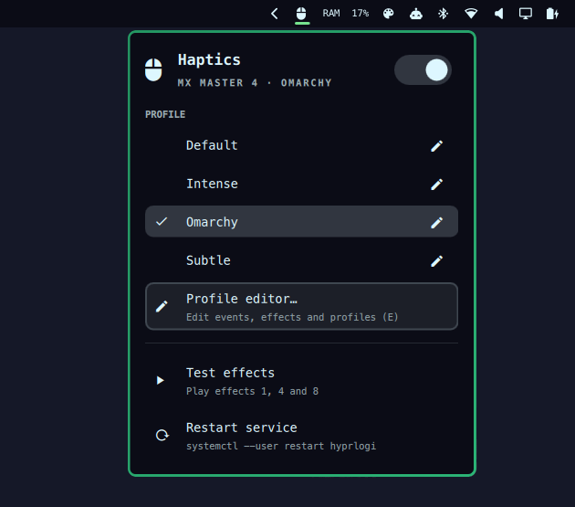

# HyprLogi for Omarchy



An [Omarchy](https://omarchy.org/) bar widget for [HyprLogi](https://github.com/mfabijanic/hyprlogi), the daemon
that plays haptic feedback on Logitech mice (MX Master 4) for Hyprland events.

- **Bar icon**: a mouse while haptics run, a crossed-out mouse while they are paused, and an urgent warning when
  the daemon is not running or HyprLogi is not installed. The tooltip names the active profile.
- **Panel**: a switch to pause and resume haptics, the profile list (click to switch, the daemon picks it up at
  once), *Test effects* and *Restart service*.
- **Profile editor**: *Profile editor…* under the profile list opens HyprLogi's editor on the active profile, and
  the pencil next to a profile opens it on that profile. Both show only when HyprLogi 0.4.1+ reports that its
  editor can start (GTK 4 and libadwaita installed); if the editor is already open, it is brought to the front.
- **Mouse**: left click opens the panel, middle click pauses or resumes, right click refreshes.
- **Keyboard** (panel open): arrows and Enter, `P` pause/resume, `E` profile editor, `T` test, `R` refresh.

The widget only runs the `hyprlogi` command (`status --json`, `toggle`, `profile set`, `play`) and starts
`hyprlogi-gui`; it needs HyprLogi 0.3.0 or newer (0.4.1 or newer for the profile editor).

## Install

**1. Install HyprLogi** (skip if `hyprlogi --version` already prints 0.3.0 or newer). On Arch / Omarchy, build it
from the [latest release](https://github.com/mfabijanic/hyprlogi/releases/latest) and start its service:

```sh
mkdir -p ~/.cache/hyprlogi-pkg && cd ~/.cache/hyprlogi-pkg
curl -LO https://github.com/mfabijanic/hyprlogi/releases/latest/download/PKGBUILD
curl -LO https://github.com/mfabijanic/hyprlogi/releases/latest/download/hyprlogi.install
makepkg -si
systemctl --user enable --now hyprlogi.service
```

Other distributions: see the release notes. Check that it finds your mouse with `hyprlogi devices`.

**2. Add the widget**, together with HyprLogi's Omarchy menu and hooks:

```sh
hyprlogi omarchy install --plugin
```

or just the widget:

```sh
omarchy plugin add https://github.com/mfabijanic/hyprlogi-omarchy.git --enable
```

The widget lands in the right section of the bar; move it with `omarchy bar move mfabijanic.hyprlogi --section left`.
Its only setting, the refresh interval (default 10 s), is under Setup > Plugins.

## Remove

```sh
omarchy plugin remove mfabijanic.hyprlogi
```

This removes only the widget. HyprLogi itself, its menu entries and hooks stay: `hyprlogi omarchy uninstall`
removes the menu entries and hooks, and the [HyprLogi README](https://github.com/mfabijanic/hyprlogi#remove)
covers removing HyprLogi.

## Requirements

- [HyprLogi](https://github.com/mfabijanic/hyprlogi) 0.3.0 or newer (0.4.1+ for the profile editor), with its service running
  (`systemctl --user enable --now hyprlogi.service`). Without it the icon shows a warning and the panel explains
  how to install it.
- A Logitech mouse with haptic feedback (tested with the MX Master 4), through OpenLogi's or HyprLogi's udev rule.

The widget writes nothing to your configuration: it only runs `hyprlogi` and `systemctl --user restart hyprlogi`.

## Development

The shell watches `~/.config/omarchy/plugins/` with `inotifywait -r`, which does not follow symlinks, so work in a
checkout inside that directory (it is what `omarchy plugin add` creates anyway):

```sh
git clone git@github.com:mfabijanic/hyprlogi-omarchy.git ~/.config/omarchy/plugins/mfabijanic.hyprlogi
omarchy-shell shell rescanPlugins
omarchy plugin enable mfabijanic.hyprlogi
```

Saving a file there reloads the widget. If a change does not show up (the panel can keep an old instance), run
`omarchy restart shell`.

- `omarchy plugin validate .` checks the manifest.
- `node --test tests/` tests the pure logic in `Model.js`.
- `qs log -p /usr/share/omarchy/shell -t 200` shows the shell log (QML errors).
- `qs -p /usr/share/omarchy/shell ipc call mfabijanic.hyprlogi open` opens the panel.

## License

GPL-3.0-or-later, like HyprLogi.
